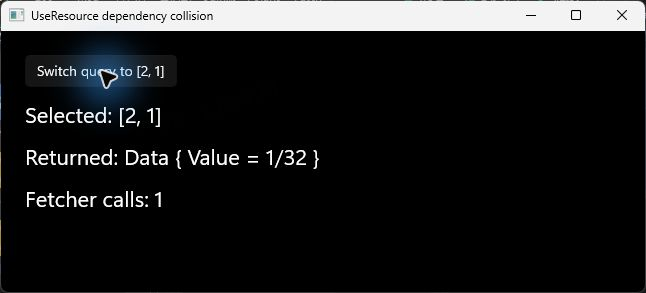
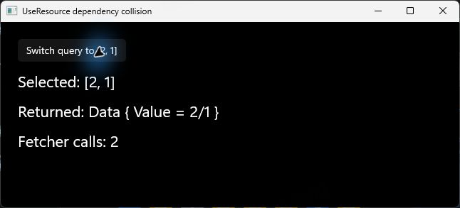

# UseResource dependency collision repro

This branch starts from upstream commit `16062a1283235769fd5c39b0cbb45b1413ec9fe8`
and adds only this repro directory. The Reactor implementation is unchanged.
The fix is on the separate [`fix/resource-dependency-identity` branch](https://github.com/PaperHammer/microsoft-ui-reactor/tree/fix/resource-dependency-identity).

Requirements: Windows, .NET 10 SDK, and NuGet access for the first restore. Tested on x64.

## Clone and reproduce

```powershell
git clone --branch repro/resource-deps-collision https://github.com/PaperHammer/microsoft-ui-reactor.git reactor-resource-repro
cd reactor-resource-repro
pwsh -File .\repros\resource-dependency-collision\Run-Repro.ps1
```

The script builds the existing `Reactor.Tests` host with the external
[`ResourceCollisionReproTests.cs`](ResourceCollisionReproTests.cs) file and runs
only that test. It does not add files to `tests/` or change the runtime.

**Expected on this branch: one failing test, exit code 2.** A successful reproduction
must show the data assertion below; a restore/build failure is not a reproduction.

```text
query=[1,32], returned=Data { Value = 1/32 }, fetcher calls=1
query=[2,1], returned=Data { Value = 1/32 }, fetcher calls=1

Expected: Data { Value = 2/1 }
Actual:   Data { Value = 1/32 }
```

The two query parameters can represent `(workspaceId, ticketId)` in a detail view.
The fetcher returns those parameters directly, isolating the hook's behavior from
HTTP, database state, and async completion ordering. Both dependency arrays hash to
16400 under the current `h = h * 31 + value.GetHashCode()` fold, starting at 17.
No custom hash implementation, explicit cache key, or array mutation is involved.

## Optional window repro

```powershell
dotnet run --project .\repros\resource-dependency-collision\ResourceCollisionDemo.csproj -c Release -p:Platform=x64 -p:SkipSignaturesGen=true -p:SkipReactorApiGen=true
```

Click **Switch query to [2, 1]**. The selection changes, but the returned successful
`Data` remains `1/32` and the fetcher count remains 1. The expected result is `2/1`
with two calls. This is not the previous value of a pending reload.

| Original runtime | Fixed runtime |
| --- | --- |
|  |  |

## Compare with the fix

Keep the repro checkout, and clone the fix into a second directory next to it:

```powershell
cd ..
git clone --branch fix/resource-dependency-identity https://github.com/PaperHammer/microsoft-ui-reactor.git reactor-resource-fixed
cd reactor-resource-repro
pwsh -File .\repros\resource-dependency-collision\Run-Repro.ps1 -Repository ..\reactor-resource-fixed -Name fixed
```

This uses the **same test source** against the fixed checkout. Expected: one passing
test, exit code 0, `Data { Value = 2/1 }`, and two fetcher calls.

The recorded output is in [original-output.txt](original-output.txt) and
[fixed-output.txt](fixed-output.txt). The screenshots and recorded output were
captured from the same base commit and its local fix on 2026-10-28.
The script skips API/signature regeneration and the unrelated native Copilot CLI
download because this check only needs the managed resource hook.

To view the fixed runtime in the same window project, first close any running repro
window, then add `-p:ReactorRoot=ABSOLUTE_PATH_TO_FIXED_CHECKOUT` to the window command.
